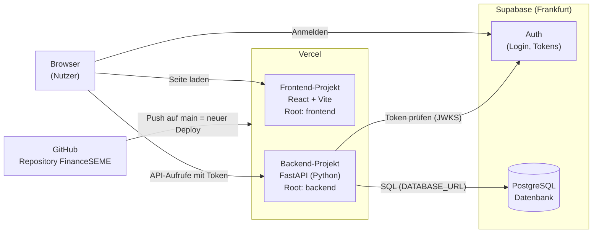
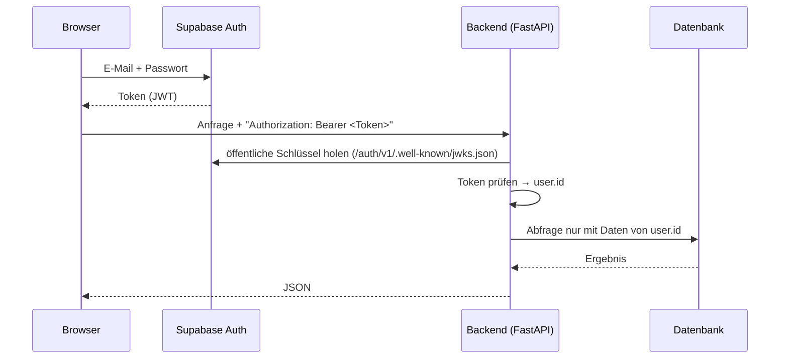
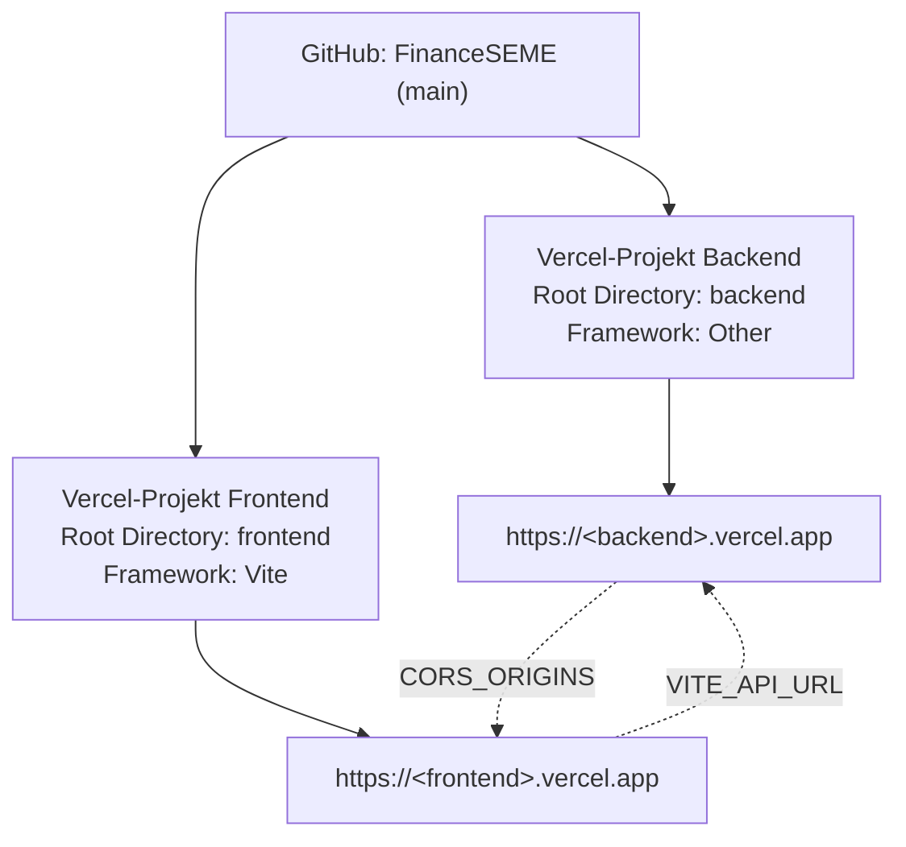

# Hosting – wie FinanceSEME online und lokal läuft

Diese Anleitung beschreibt, wie das Hosting eingerichtet ist: Supabase (Datenbank + Login),
Vercel (Backend + Frontend) und die lokale Entwicklungsumgebung.
Kurzfassung der Befehle steht auch in der [README](../README.md).

> **Bilder:** Die Diagramme unten zeichnet GitHub automatisch.
> Stellen mit 📷 sind Screenshots aus den Dashboards von Supabase und Vercel. Die müssen wir
> selbst aufnehmen und in [`docs/bilder/`](bilder/) ablegen (Liste siehe dort).

---

## 1. Überblick



| Teil | Technik | Läuft bei | Ordner |
|---|---|---|---|
| Frontend | React 18 + Vite | Vercel, eigenes Projekt | `frontend/` |
| Backend | Python, FastAPI | Vercel, eigenes Projekt (Serverless-Funktion) | `backend/` |
| Datenbank | PostgreSQL | Supabase, Region Frankfurt | Tabellen über Alembic (`backend/alembic/`) |
| Login | Supabase Auth | Supabase | Frontend: `src/lib/supabase.js`, Backend: `app/services/auth_service.py` |

## 2. Wie der Login funktioniert



- Das Frontend meldet sich direkt bei Supabase an. Das Backend speichert keine Passwörter.
- Das Backend prüft das Token mit den öffentlichen Schlüsseln von Supabase. Dafür braucht es
  `SUPABASE_URL`. Nur bei älteren Projekten mit HS256-Tokens braucht es zusätzlich `SUPABASE_JWT_SECRET`.
- Jede Abfrage filtert auf den eingeloggten Nutzer. Fremde Daten → 404.

## 3. Umgebungsvariablen

Werte stehen **lokal** in `backend/.env` bzw. `frontend/.env` (nie committen!)
und **online** in Vercel unter *Project → Settings → Environment Variables*.

### Backend (`backend/.env` bzw. Vercel-Projekt „Backend“)

| Variable | Wofür | Woher | Geheim? |
|---|---|---|---|
| `DATABASE_URL` | Verbindung zur Datenbank | Supabase → **Connect** → Pooler-Adresse (beginnt mit `postgresql://`), `<passwort>` ersetzen | **ja** |
| `SUPABASE_URL` | Tokens prüfen | Supabase → **Project Settings → API** → Project URL, z. B. `https://<projekt-id>.supabase.co` | nein |
| `SUPABASE_JWT_SECRET` | Nur für alte HS256-Tokens | Supabase → **Project Settings → API → JWT Secret** | **ja**, nie ins Frontend |
| `CORS_ORIGINS` | Welche Frontend-Adressen das Backend aufrufen dürfen | selbst eintragen, z. B. `["http://localhost:5173","https://<frontend>.vercel.app"]` | nein |

### Frontend (`frontend/.env` bzw. Vercel-Projekt „Frontend“)

| Variable | Wofür | Woher | Geheim? |
|---|---|---|---|
| `VITE_API_URL` | Adresse des Backends | lokal `http://localhost:8000`, online `https://<backend>.vercel.app` | nein |
| `VITE_SUPABASE_URL` | Login bei Supabase | gleiche Adresse wie `SUPABASE_URL` | nein |
| `VITE_SUPABASE_KEY` | Login bei Supabase | Supabase → **Project Settings → API** → *anon* / *publishable* key | nein (öffentlich) |

> ⚠️ Alles mit `VITE_` wird in den Code fürs Browserfenster eingebaut und ist für jeden sichtbar.
> Dort nie `SUPABASE_JWT_SECRET`, den `service_role`-Schlüssel oder das Datenbank-Passwort eintragen.
>
> ⚠️ Geänderte `VITE_...`-Werte wirken erst nach einem **neuen Deploy** (online) bzw. nach
> Neustart von `npm run dev` (lokal).

## 4. Supabase einrichten

1. Auf [supabase.com](https://supabase.com) ein neues Projekt anlegen, Region **Frankfurt (eu-central-1)**.
   Datenbank-Passwort sicher aufheben (kommt in `DATABASE_URL`).
   📷 `bilder/supabase-neues-projekt.png`
2. **Connect** (oben) → Pooler-Adresse kopieren → wird `DATABASE_URL`.
   📷 `bilder/supabase-connect.png`
3. **Project Settings → API**: Project URL und *anon/publishable key* kopieren.
   📷 `bilder/supabase-api.png`
4. **Authentication → URL Configuration**: Bei *Site URL* die Frontend-Adresse von Vercel eintragen,
   bei *Redirect URLs* zusätzlich `http://localhost:5173`. Sonst führt der Link in der Bestätigungs-Mail ins Leere.
   📷 `bilder/supabase-url-config.png`
5. Tabellen anlegen: lokal in `backend` den Befehl `alembic upgrade head` ausführen (siehe Abschnitt 6).
   Danach sind sie im **Table Editor** sichtbar.
   📷 `bilder/supabase-table-editor.png`

**Row Level Security:** Alle Tabellen sind mit `ENABLE ROW LEVEL SECURITY` gesperrt. So kann niemand
mit dem öffentlichen Schlüssel direkt über die Supabase-API lesen. Unser Backend verbindet sich direkt
mit der Datenbank und ist davon nicht betroffen. Neue Tabellen müssen in ihrer Migration auch gesperrt werden.

## 5. Vercel einrichten

Zwei Projekte aus **demselben** GitHub-Repository. Jeder Push auf `main` löst bei beiden automatisch
einen neuen Deploy aus.



### 5.1 Backend-Projekt
1. Vercel → **Add New → Project** → Repository `FinanceSEME` importieren.
2. **Root Directory:** `backend`, **Framework Preset:** Other.
   📷 `bilder/vercel-backend-root.png`
3. **Environment Variables:** `DATABASE_URL`, `SUPABASE_URL` (falls nötig `SUPABASE_JWT_SECRET`).
   `CORS_ORIGINS` kommt erst in Schritt 5.3.
   📷 `bilder/vercel-backend-env.png`
4. **Deploy**. Test im Browser: `https://<backend>.vercel.app/health` → `{"status":"ok"}`.

Wie das technisch geht:
- `backend/api/index.py` ist der Einstieg. Vercel startet diese Datei als Python-Funktion und findet darin die FastAPI-App.
- `backend/vercel.json` leitet **alle** Pfade (`/accounts`, `/docs`, …) an diese eine Funktion weiter.
- Vercel installiert die Pakete aus `backend/requirements.txt` selbst.

### 5.2 Frontend-Projekt
1. Noch einmal **Add New → Project** mit demselben Repository.
2. **Root Directory:** `frontend`, Framework **Vite** (wird erkannt).
   📷 `bilder/vercel-frontend-root.png`
3. **Environment Variables:** `VITE_API_URL` (Backend-Adresse aus 5.1), `VITE_SUPABASE_URL`, `VITE_SUPABASE_KEY`.
   📷 `bilder/vercel-frontend-env.png`
4. **Deploy**.

`frontend/vercel.json` leitet alle Pfade auf `index.html`. So funktionieren auch direkte Links
wie `/transactions` und das Neuladen der Seite.

### 5.3 Beide verbinden
1. Im **Backend**-Projekt `CORS_ORIGINS` setzen:
   `["http://localhost:5173","https://<frontend>.vercel.app"]` → **Deployments → Redeploy**.
2. In Supabase die Frontend-Adresse als *Site URL* eintragen (Abschnitt 4, Schritt 4).
3. Testen: Frontend-Adresse öffnen, registrieren, anmelden, Konto anlegen.
   📷 `bilder/app-dashboard.png`

## 6. Lokal entwickeln (Windows)

Voraussetzungen: **Python 3.11+** und **Node.js 20+**.
Bei uns: Python 3.13 (über `py` aufrufbar, nicht im PATH), Node.js 24.

```
cd backend
py -3.13 -m venv .venv
.venv\Scripts\activate
pip install -r requirements.txt
copy .env.example .env          # dann Werte eintragen (Abschnitt 3)
alembic upgrade head            # Tabellen in Supabase anlegen/aktualisieren
uvicorn app.main:app --reload   # http://localhost:8000/docs
```

```
cd frontend
npm install
copy .env.example .env          # dann Werte eintragen (Abschnitt 3)
npm run dev                     # http://localhost:5173
```

- `uvicorn --reload` lädt bei Code-Änderungen neu, aber **nicht** bei Änderungen an `.env`.
  Dann den Server mit Strg+C stoppen und neu starten.
- Lokal und online nutzen **dieselbe** Supabase-Datenbank. Testdaten von lokal sind also auch online sichtbar.

## 7. Häufige Fehler

| Fehler | Ursache | Lösung |
|---|---|---|
| `401 Token ungültig` | `SUPABASE_URL` fehlt oder ist falsch | Wert im Backend prüfen, neu starten / redeployen |
| Browser meldet CORS-Fehler | Frontend-Adresse fehlt in `CORS_ORIGINS` | ergänzen, Backend redeployen |
| Frontend ruft `localhost:8000` auf, obwohl online | `VITE_API_URL` nicht gesetzt oder nach Änderung nicht neu deployed | setzen, Frontend redeployen |
| Bestätigungs-Mail führt auf falsche Seite | *Site URL* in Supabase falsch | Abschnitt 4, Schritt 4 |
| `python` wird nicht gefunden | Python nicht im PATH | `py` benutzen oder vorher `.venv\Scripts\activate` |
| Backend online: „too many connections“ | Vercel startet viele Funktionen parallel, jede mit eigener Verbindung | in `DATABASE_URL` den **Transaction pooler** (Port 6543) statt Session pooler (5432) verwenden |
